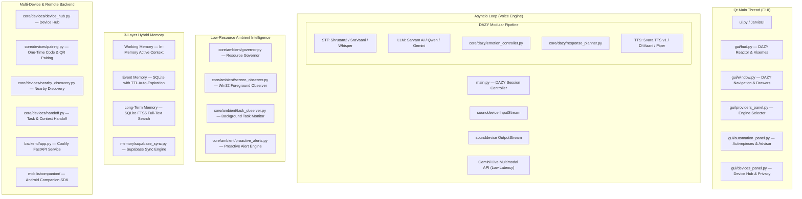

# DAZY — Architecture & System Blueprint
### Designed & Customised by Tarik
*Based on the Mark-LVII foundation by FatihMakes (Licensed under CC BY-NC 4.0)*

---

## 1. Executive Summary

**DAZY** is an original Indian female-voice, emotionally intelligent, multilingual desktop AI assistant and multi-device personal companion. Built upon the robust engineering foundation of Mark-LVII, DAZY combines:
- Real-time bidirectional voice streaming (Gemini Live & modular Indian speech pipelines).
- Expressive Indian voice synthesis (Svara TTS v1 with emotion tags, DhVaani 0.5 Indic fallback, and Piper).
- Indian multilingual speech recognition (BharatGen Shrutam2, SraVaani 1.0, and Whisper).
- Emotion understanding across 10 core emotional states with conversational momentum and decay.
- Cultural and religious knowledge collections (Islamic authentic sources & Indo-Islamic heritage).
- Model Context Protocol (MCP) tool integration and dynamic agent skills.
- Low-Resource Ambient Intelligence: Event-driven Windows active window awareness and Resource Governor.
- 3-Layer Memory Architecture: Transient Working Memory, Short-Term Event Memory (with TTL), and Long-Term Memory with SQLite FTS5 full-text search.
- Supabase Cloud Synchronization: Project `mllmkgwlkmbnaclanunr` (`https://mllmkgwlkmbnaclanunr.supabase.co`).
- Multi-Device Ecosystem: Windows Desktop, Android Mobile Companion, QR/One-Time Code pairing, and Cross-Device Task Context Handoff.
- Cloud Backend: Lightweight Python FastAPI microservice ready for Coolify deployment with Docker.

---

## 2. Architectural Blueprint

---

## 3. Low-Resource Ambient Intelligence Design Principles
1. **Event-Driven, Not Polling**:
   - Uses native Windows `GetForegroundWindow` and UI Automation events instead of high-frequency full-screen recording or continuous background OCR.
   - De-duplicates consecutive identical window contexts.
2. **Adaptive Resource Governor**:
   - Inspects CPU, RAM, and battery status via `psutil`.
   - Transitions between `NORMAL`, `THROTTLED` (when CPU > 75%, RAM > 80%, or on battery), and `SUSPENDED` (battery < 12% or CPU > 90%).
   - Enforces storage ceiling (default 250 MB) and auto-prunes oldest temporary caches.
3. **Proactive Alerts with Cooldown**:
   - Delivers friendly, respectful updates when background tasks finish or system needs attention.
   - Built-in deduplication cooldown prevents spamming the user.

---

## 4. Multi-Device & Supabase Cloud Integration
1. **Project Details**:
   - Supabase URL: `https://mllmkgwlkmbnaclanunr.supabase.co`
   - Project Ref: `mllmkgwlkmbnaclanunr`
   - Local-first offline resilience: records queued in SQLite `sync_queue` table and synced when online.
2. **Device Trust & Handoff**:
   - 6-digit one-time code and QR payload for Android Companion enrollment.
   - Permission-based context handoff enables starting work on Windows desktop and reviewing on Android.
3. **Coolify VPS Deployment**:
   - Containerized via `backend/Dockerfile` with non-root user.
   - Inbound webhook relay endpoint protects Windows PC from exposing public ports to the internet.
