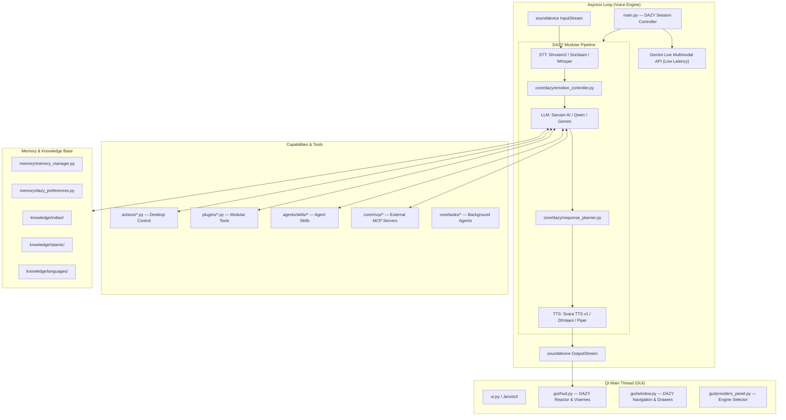

# DAZY — Architecture & System Blueprint
### Designed & Customised by Tarik
*Based on the Mark-LVII foundation by FatihMakes (Licensed under CC BY-NC 4.0)*

---

## 1. Executive Summary

**DAZY** is an original Indian female-voice, emotionally intelligent, multilingual desktop AI assistant and companion. Built upon the robust engineering foundation of Mark-LVII, DAZY combines:
- Real-time bidirectional voice streaming (Gemini Live & modular Indian speech pipelines).
- Expressive Indian voice synthesis (Svara TTS v1 with emotion tags, DhVaani 0.5 Indic fallback, and Piper).
- Indian multilingual speech recognition (BharatGen Shrutam2, SraVaani 1.0, and Whisper).
- Emotion understanding across 10 core emotional states with conversational momentum and decay.
- Cultural and religious knowledge collections (Islamic authentic sources & Indo-Islamic heritage).
- Model Context Protocol (MCP) tool integration and dynamic agent skills.
- Full local desktop control, task checkpointing, and background research agents.

---

## 2. Architectural Blueprint

---

## 3. Core Architectural Invariants

1. **Strict UI-Thread Invariant**:
   - `actions/`, `plugins/`, `core/tasks/`, and `core/mcp/` execute on background worker threads.
   - Workers never instantiate or mutate Qt widgets directly. All UI notifications travel through thread-safe `pyqtSignal` methods on `player` (`JarvisUI`).

2. **Dual-Path Voice Engine**:
   - **Gemini Live Path**: Sub-second multimodal streaming for ultra-low latency.
   - **DAZY Modular Pipeline**: Deep Indian code-switching (Shrutam2) → Emotional Planning → Svara/DhVaani synthesis with native emotion tags.

3. **Background Agent Boundaries**:
   - Research sub-agents are strictly isolated with read-only tools and cannot trigger destructive desktop modifications.

4. **Lazy Import Discipline**:
   - Heavy machine learning libraries (Torch, OpenVINO, Faster-Whisper, MCP SDK) are loaded lazily on first invocation, guaranteeing instant startup.

5. **Verified Tool Execution**:
   - Destructive actions (shutdown, restart, wifi toggle, file removal) pass through `core/confirm.py` and `core/undo.py`.
