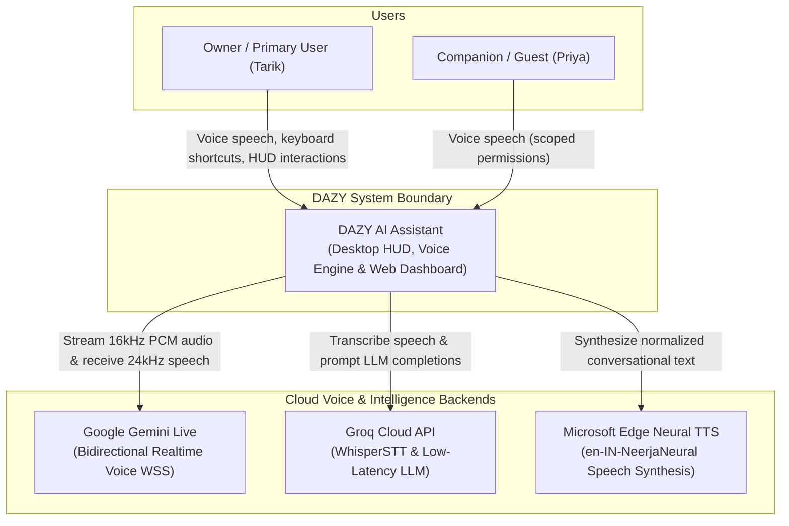
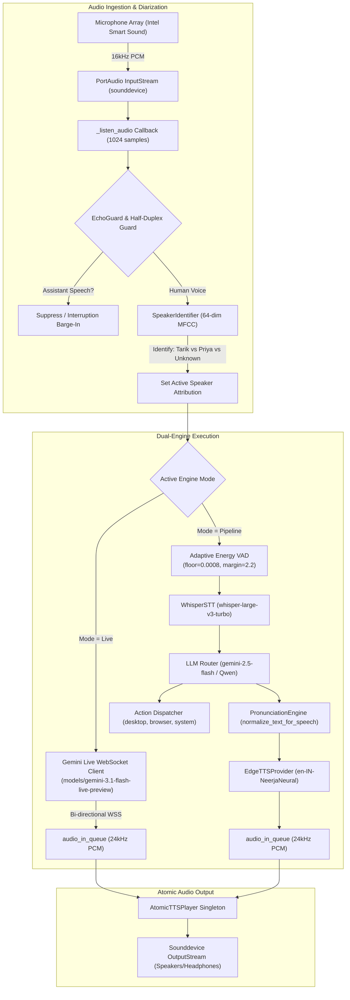
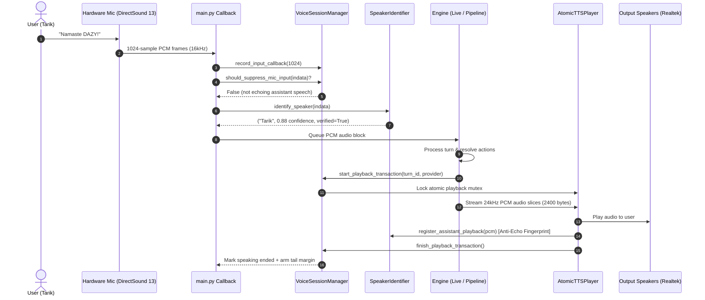

# DAZY C4 Architecture Models & Dynamic Execution Flows

This document details the architectural models for the **DAZY AI Assistant** using the C4 model standard and Mermaid visual specifications.

---

## 1. C4 Level 1: System Context Diagram



---

## 2. C4 Level 2: Container Diagram

```mermaid
flowchart TB
    subgraph Presentation_Layer [Presentation Layer]
        HUD["Desktop HUD GUI<br/>(PyQt6)<br/>Renders avatar, visemes, and audio bars"]
        WebDash["Remote Web Dashboard<br/>(HTML5 / WebSockets)<br/>Mobile control, metrics, phone audio relay"]
    end

    subgraph Core_Daemon [DAZY Core Execution Daemon (Python 3.14 AsyncIO)]
        Orchestrator["Core Orchestrator<br/>(main.py)<br/>Event loop, device routing, tool dispatch"]
        VoiceManager["Voice Session Manager<br/>(core/voice_session_manager.py)<br/>Atomic single-voice & playback transactions"]
        DualEngine["Dual-Engine Subsystem<br/>(Gemini Live & Pipeline Engine)"]
        WebServer["Starlette ASGI Server<br/>(dashboard/server.py :8080)<br/>REST APIs, token auth, WebSockets"]
    end

    subgraph Storage [Persistence Layer]
        Config["Memory Ledger<br/>(config_manager.py / api_keys.json)"]
        Profiles["Voice Profiles & Pronunciation Dict<br/>(enrolled_speakers.json / pronunciation_dict.json)"]
    end

    HUD <-->|"Events & Queue Bridges"| Orchestrator
    WebDash <-->|"REST & Secure WSS (AES-256-GCM)"| WebServer
    WebServer <-->|"Metrics & Commands"| VoiceManager
    Orchestrator --> VoiceManager
    Orchestrator --> DualEngine
    Orchestrator <--> Storage
```

---

## 3. C4 Level 3: Component Diagram (Core Orchestrator & Audio Path)



---

## 4. Dynamic Flow: End-to-End Turn Execution


