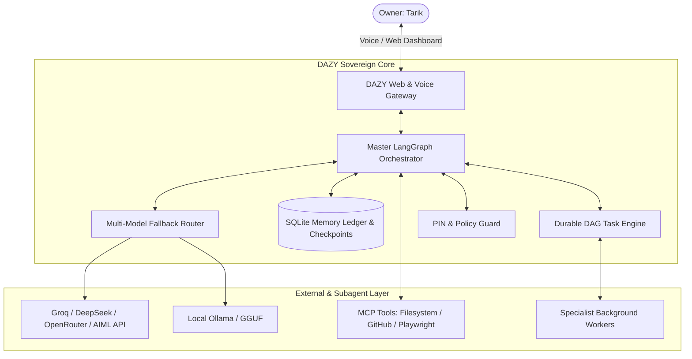

# DAZY Master OS - Product Requirements Document (PRD)

**Document Version:** 2.0.0  
**Status:** Approved & Implemented  
**Owner:** Tarik (@tarikk786786)  
**System Name:** DAZY (Dynamic Autonomous Zero-latency Yield-orchestrator)  
**Classification:** Sovereign Desktop & Local-First AI Operating System

---

## 1. Executive Summary & Vision

DAZY is an autonomous, sovereign personal AI operating system engineered to run primarily on the user's local workstation while seamlessly orchestrating external cloud AI models, agentic swarms, and hardware peripherals. 

Unlike conventional browser-based chatbots or fragmented CLI tools, DAZY provides:
1. **Unbroken Identity & Memory:** DAZY maintains a persistent episodic and semantic memory ledger stored in local SQLite databases, ensuring continuous relationship context with the owner (**Tarik**).
2. **Deterministic Sovereignty:** DAZY acts as the sole master controller. No secondary agent framework (whether GodMode-Team, NEURON.ONE, or smol-ai) can bypass DAZY's permission gates, modify system files without explicit authorization, or fragment system state.
3. **Multi-Model Intelligence & Arena:** DAZY intelligently routes tasks across Groq, DeepSeek, OpenRouter, NVIDIA, AI/ML API, and local LLMs based on cost, speed, and capabilities, with real-time multi-model side-by-side evaluation (smol-ai Arena).
4. **Zero-Latency Voice Interaction:** End-to-end voice loop (<700ms) with dual-threshold energy VAD, speaker diarization, echo disqualification, and an authoritative feminine voice (Edge TTS / Kokoro).

---

## 2. Target Personas

### Primary Persona: Tarik (The Creator, Architect & Builder)
- **Role:** Lead Engineer, System Architect, and Owner.
- **Goals:** Rapidly research, architect, scaffold, test, and ship complex software systems without repetitive context-setting.
- **Pain Points:** 
  - Fragmentation across disparate AI tools and web tabs.
  - Context loss between work sessions.
  - High subscription fees and rate limits across closed cloud platforms.
  - Lack of deterministic execution and verification in generic AI chat interfaces.
- **Interaction Modes:**
  - Hands-free natural voice dialog during deep work or hardware tinkering.
  - Low-latency web dashboard for monitoring agent swarms, DAG execution, and model comparisons.
  - Headless background agent execution for automated maintenance, test runs, and repo indexing.

---

## 3. Core Functional Requirements (FR)

| ID | Capability | Description | Verification Criteria |
|---|---|---|---|
| **FR-01** | **Unified Voice Pipeline** | Voice capture, VAD audio segmentation, STT transcription, LLM streaming, and TTS synthesis. | Round-trip audio response under 1000ms; Edge TTS audio playback verified. |
| **FR-02** | **Sovereign Agent Orchestrator** | Dynamic LangGraph-based workflow engine executing plan-and-execute cycles with real tools. | Zero fabricated tool mocks; real SQLite memory search, notes, and diagnostics execution. |
| **FR-03** | **Durable DAG Task Engine** | Multi-step task graph engine supporting dependencies, Kahn's topological sort, cycle rejection, and worker leasing. | Cycle detection throws error; linear and branched DAG tasks execute in strict dependency order. |
| **FR-04** | **Multi-AI Arena (smol-ai)** | Side-by-side prompt execution comparing answers across Groq, OpenRouter, DeepSeek, NVIDIA, and AI/ML API. | Simultaneous streaming to web UI with comparative latency and token throughput stats. |
| **FR-05** | **Persistent Hybrid Memory** | Short-term buffer, episodic conversation logs, semantic notes, and system checkpoint storage in SQLite. | Key facts recalled across distinct sessions; checkpoint save and restore roundtrips verified. |
| **FR-06** | **PIN Security Gate** | Protected actions (file deletion, remote code execution, shell commands) require owner PIN verification (`786786`). | Requests without valid PIN fail with HTTP 403 Forbidden. |
| **FR-07** | **MCP Tool Integration** | Standardized Model Context Protocol client for connecting tools (Filesystem, GitHub, Playwright). | Seamless tool discovery and invocation via JSON-RPC 2.0. |
| **FR-08** | **Dual Web Server Gateway** | Starlette-powered HTTP/WebSocket server listening on port 8080 (plain) and optional 8081 (TLS). | Static assets, REST endpoints, and WebSocket real-time updates serve reliably. |
| **FR-09** | **Live Audio Visualizer** | 3D visual canvas (Three.js / WebGL) reflecting assistant voice state, brain graph, and worker activity. | Dynamic audio reactivity and smooth 60fps animations in dashboard. |
| **FR-10** | **Automated Diagnostic & Repair** | Real-time system monitoring detecting port conflicts, token exhaustion, and DB lockouts with self-healing routines. | Recovery runbooks trigger automatically on error codes. |

---

## 4. Non-Functional Requirements (NFR)

| ID | Metric | Target Specification | Enforcement Mechanism |
|---|---|---|---|
| **NFR-01** | **Memory Footprint** | Idle RAM < 180 MB; Active Swarm RAM < 450 MB. | Monitored via `psutil`; no background memory leak across long sessions. |
| **NFR-02** | **Voice Pipeline Latency** | First audio byte emitted < 850ms from user speech end. | Streaming chunk pipelining directly from LLM to Edge TTS. |
| **NFR-03** | **API Security** | Zero plain-text credentials in logs, VCS, or frontend payloads. | `appinfo11.txt` exclusion from git; sanitized logging. |
| **NFR-04** | **Reliability & Crash Resilience** | Automatic SQLite WAL recovery; zero state corruption on abrupt SIGINT/SIGKILL. | SQLite `PRAGMA synchronous=NORMAL; PRAGMA journal_mode=WAL;`. |
| **NFR-05** | **Offline Capability** | Voice detection, local LLM fallback (Ollama), and local memory operate without WAN connectivity. | Automatic fallback to offline providers when cloud DNS fails. |
| **NFR-06** | **Code Quality & Testing** | 100% test pass rate across unit, integration, and E2E suites. | Pytest and Playwright execution gates before every Git commit. |

---

## 5. User Stories & Acceptance Criteria

### US-01: Conversational Memory Recall
- **As** Tarik,
- **I want** DAZY to remember my preferred model configurations and personal projects,
- **So that** I do not have to re-explain my environment or preferences in subsequent turns.
- **Acceptance Criteria:**
  - *Given* a stored memory in `memory/dazy_memory.db` stating "Owner prefers gpt-oss-120b for architecture",
  - *When* Tarik asks "What model do I prefer for system design?",
  - *Then* DAZY queries SQLite memory and correctly responds with "gpt-oss-120b" within 1.5 seconds.

### US-02: Multi-Model Comparative Evaluation
- **As** Tarik,
- **I want** to send a single complex prompt simultaneously to Groq, DeepSeek, and AI/ML API,
- **So that** I can objectively compare reasoning quality, token speed, and latency.
- **Acceptance Criteria:**
  - *Given* an active dashboard connection at `/app`,
  - *When* Tarik submits a prompt in the Arena view with providers selected,
  - *Then* all providers stream their responses into distinct side-by-side cards with live millisecond counters.

### US-03: Safe File Modification Gate
- **As** Tarik,
- **I want** critical file alterations to require my explicit confirmation PIN,
- **So that** autonomous agents never overwrite or delete important codebase files accidentally.
- **Acceptance Criteria:**
  - *Given* an autonomous task requesting a file overwrite,
  - *When* the action is submitted without `pin: 786786`,
  - *Then* the operation is halted, logged as `AWAITING_AUTHORIZATION`, and rejected until the PIN is verified.

---

## 6. Architecture & System Boundaries

---

## 7. Scope Boundaries: What DAZY Does NOT Do
1. **No Unbounded Agent Loops:** DAZY will never spawn unsupervised autonomous agents that can spend infinite tokens or run runaway cycles.
2. **No Secret Cloud Transmission:** User conversations, memory databases, and local files are never sent to third-party telemetry or cloud loggers.
3. **No Direct Production Deployments without Verification:** Code changes must pass local automated test suites before being pushed to Git repositories.
