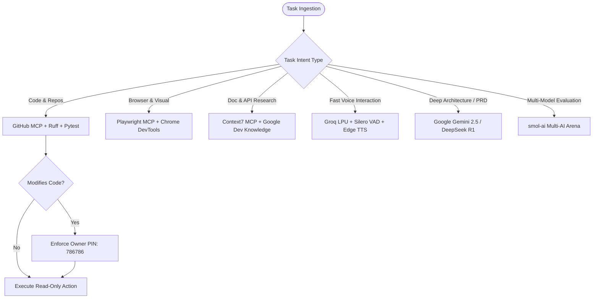

# DAZY Ecosystem: Searchable Tool, Library & MCP Registry

**Document Version:** 2.0.0  
**Owner:** Tarik (@tarikk786786)  
**System Name:** DAZY Master AI Operating System  
**Classification:** Enterprise Capability & Integration Catalog

---

## 1. Overview & Evaluation Framework

This registry documents all external and internal intelligence providers, tools, libraries, MCP servers, and frameworks integrated or qualified for DAZY. Every component is evaluated across six rigorous dimensions:
1. **Latency & Throughput:** Suitability for sub-second real-time voice and streaming agent workflows.
2. **Cost & Licensing:** Preference for free, open-source (MIT/Apache 2.0), or cost-effective pay-per-token models.
3. **Privacy & Sovereignty:** Local-first execution capability vs cloud dependency; zero unauthorized data egress.
4. **Reliability & Availability:** Uptime history, rate-limit resilience, and fallback support.
5. **Developer Experience:** Clear OpenAPI/JSON-RPC schemas, typed SDKs, and error diagnostics.
6. **DAZY Compatibility:** Native integration into DAZY's LangGraph orchestrator and Starlette gateway.

---

## 2. LLM & Reasoning Providers

| Provider | Primary Models | Integration Mode | Latency (TTFT) | Cost Profile | Role in DAZY |
|---|---|---|---|---|---|
| **Google Gemini** | `gemini-2.5-flash`, `gemini-1.5-pro` | Official SDK / REST | ~280ms | Free Tier / PayG | High-context reasoning, multimodal vision/audio, 1M+ token context |
| **Groq Cloud** | `openai/gpt-oss-120b`, `qwen/qwen3.8-27b` | OpenAI-compatible | ~110ms | Free Tier / PayG | Ultra-low latency voice companion loop & real-time streaming |
| **DeepSeek** | `deepseek-chat`, `deepseek-reasoner` (R1) | OpenAI-compatible | ~650ms | Ultra-low cost | Deep algorithmic reasoning, complex math & code generation |
| **OpenRouter** | 200+ models (Anthropic, Meta, Mistral) | OpenAI-compatible | ~350ms | PayG (credits) | Universal multi-model aggregator & smol-ai Arena provider |
| **NVIDIA NIM** | `meta/llama-3.3-70b-instruct` | OpenAI-compatible | ~210ms | Enterprise / Free | Hardware-accelerated inference & specialized enterprise tasks |
| **AI/ML API** | Unified gateway for 100+ models | OpenAI-compatible | ~300ms | PayG (Key Active) | Multi-model Arena benchmark & secondary provider backup |
| **Local Ollama** | `llama3.2`, `qwen2.5-coder`, `mistral` | Local HTTP (11434) | ~400ms (GPU) | 100% Free | Air-gapped offline fallback when WAN connection drops |

---

## 3. Voice, Audio & Speech Processing

| Component | Technology | Execution | Latency | License | Description |
|---|---|---|---|---|---|
| **Silero VAD** | Deep learning voice activity detector | Local CPU (PyTorch/ONNX) | < 5ms | MIT | Dual-threshold speech boundary detection; isolates speech from background noise |
| **Groq Whisper** | `whisper-large-v3-turbo` | Cloud LPU (Groq API) | ~180ms | Commercial / API | Ultra-fast speech-to-text transcription with punctuation |
| **Faster-Whisper** | CTranslate2 Whisper implementation | Local CPU/GPU | ~350ms | MIT | Offline STT fallback when Internet connection is unavailable |
| **Edge TTS** | Microsoft Neural Text-to-Speech | Cloud API (Free) | ~250ms | Free / Service | High-fidelity neural voice synthesis (`en-IN-NeerjaNeural`, `Aoede`) |
| **Kokoro TTS** | Compact 82M parameter neural TTS | Local CPU/GPU | ~180ms | Apache 2.0 | Ultra-fast, natural-sounding local speech synthesis |
| **Sarvam AI** | Indic / Hinglish voice & translation models | Cloud API | ~300ms | Commercial / API | High-accuracy Hinglish speech recognition and conversational translation |

---

## 4. Model Context Protocol (MCP) Servers

| MCP Server | Transport | Tool Capabilities | Security Risk | Permission Gate |
|---|---|---|---|---|
| **GitHub MCP** | `stdio` / Node.js | Repo search, pull requests, issues, branch commits, diffs | Medium (Write) | Unrestricted Read; PIN for write/commit |
| **Filesystem MCP** | `stdio` / Node.js | Read file, write file, list directory, move, copy | High (Write) | Whitelisted to project workspace; PIN for delete/overwrite |
| **Playwright MCP** | `stdio` / Python | Headless browser navigation, click, type, screenshot, eval | Medium (Network) | Unrestricted in local dev; restricted from payment domains |
| **Memory MCP** | `stdio` / Node.js | Entity creation, relation extraction, graph traversal | Low (Internal) | Unrestricted local read/write |
| **Context7 MCP** | `sse` / HTTP | Real-time library documentation lookup and API signatures | Low (Read-only) | Unrestricted public doc queries |
| **Stitch / Figma MCP**| `stdio` / Node.js | Design file inspection, CSS token extraction, screen layout | Low (Read-only) | Unrestricted read of design assets |
| **Google Developer Knowledge**| `stdio` / Python | Google Cloud, Android, Web official doc search & code recipes | Low (Read-only) | Unrestricted read-only search |

---

## 5. Architecture, Modeling & Visualization Tools

| Tool | Format | Purpose | Ecosystem Link |
|---|---|---|---|
| **Structurizr C4 DSL** | `.dsl` text | System, Container, Component C4 architecture modeling | Renderable via Structurizr CLI, PlantUML, or Structurizr Cloud |
| **dbdiagram.io DBML** | `.dbml` text | Human-readable database schema modeling & relationship mapping | Direct import to dbdiagram.io, converts to SQL DDL |
| **OpenAPI 3.1.0** | `.yaml` specification | REST API contract definition, request/response validation | Swagger UI, Redoc, automatic client generation |
| **Mermaid** | `.mmd` / Markdown fences | Declarative sequence diagrams, state machines, and DAG graphs | Rendered natively in GitHub, GitLab, VS Code, and DAZY docs |
| **Storybook** | `.stories.jsx` / `.tsx` | Isolated component development, interaction testing & documentation | Component visual catalog and design system harness |
| **Three.js / WebGL** | `.js` / Canvas | 3D visual canvas rendering dynamic brain state & worker activity | Integrated directly into DAZY web dashboard (`app.html`) |

---

## 6. Engineering Quality, Linting & Testing Tools

| Tool | Version | Discipline | Execution Speed | Command / Integration |
|---|---|---|---|---|
| **Pytest** | `9.2.0` | Python Unit & Integration Testing | ~1.5s (full suite) | `pytest tests/` |
| **Playwright** | `1.50.0` | End-to-End Browser Automation | ~4.5s (E2E suite) | `pytest tests/test_chat_voice.py` |
| **Ruff** | `0.9.0` | Python Linter and Code Formatter | < 50ms | `ruff check --fix . && ruff format .` |
| **Biome** | `1.9.0` | JavaScript/CSS/HTML Linter & Formatter | < 40ms | `biome check --write dashboard/static/` |
| **Gitleaks** | `8.30.1` | Automated Pre-commit Secret Scanner | < 120ms | `gitleaks detect --source .` |
| **Trivy** | `0.76.2` | Dependency & Container CVE Scanner | ~2.5s | `trivy fs --security-checks vuln .` |
| **Semgrep** | `1.169.0` | AST-based Static Application Security Testing | ~3.0s | `semgrep scan --config auto` |

---

## 7. Tool Discovery & Auto-Routing Decision Matrix

When DAZY receives an objective, the routing engine selects capabilities according to the following deterministic rules:

---

## 8. Summary of Free & Open-Source Recommendations

1. **Keep Starlette + Uvicorn:** Extremely lightweight (<25MB base RAM), native async WebSockets, and zero bloat.
2. **Prioritize Free Tiers with Fallbacks:** Rely on Groq, Gemini free tiers, and local models to keep running costs near \$0/month for personal development.
3. **Use SQLite WAL Mode Exclusively:** Avoid running heavyweight PostgreSQL or MySQL servers on Windows; SQLite in WAL mode handles thousands of read queries per second with zero maintenance.
4. **Use Native Fast Linters (Ruff + Biome):** Replaced legacy slow tools (Flake8, ESLint, Prettier) with single-binary Rust-based linters for sub-second developer feedback loops.
